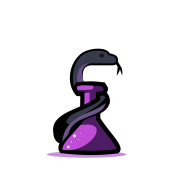

<!--
  PyTestLab – Scientific test & measurement toolbox
  =================================================
-->

<p align="center">
  
</p>

<h1 align="center">PyTestLab</h1>

<p align="center">
  Modern Python toolbox for laboratory<br/>
  test-and-measurement automation, data management&nbsp;and analysis.
</p>

<p align="center">
  <a href="https://pypi.org/project/pytestlab"></a>
  <a href="https://pytestlab.org"></a>
  <a href="https://opensource.org/licenses/Apache-2.0"></a>
  <a href="https://github.com/labiium/pytestlab/actions/workflows/test.yml"></a>
</p>

---

## ✨ Key Features

* **Unified device layer** – `Device` is the root abstraction for every automatable
  lab resource; `Instrument` is the measurement/stimulus subtype used by
  oscilloscopes, PSUs, DMMs, VNAs, AWGs, spectrum & power meters, DC loads, …
  (see `pytestlab.devices.*` and `pytestlab.instruments.*`).
* **Chainable facade API** – fluent method chaining for readable instrument control: `psu.channel(1).set(voltage=5.0, current_limit=0.1).on()`.
* **Plug-and-play profiles** – YAML descriptors validated by Pydantic & JSON-schema.
  Browse ready-made Keysight profiles in `pytestlab/profiles/keysight`.
* **Simulation mode** – exercise the API offline using profiles with a declared simulator or recorded responses.
* **Record & Replay** – record real instrument sessions and replay them exactly for reproducible measurements, offline analysis, and regression testing with strict sequence validation.
* **Bench descriptors** – group multiple instruments in one `bench.yaml`, define safety limits, automation hooks, traceability, accessory profiles, and measurement plans.
* **High-level measurement builder** – notebook-friendly `MeasurementSession` for parameter sweeps that stores data as Polars DataFrames and exports straight to the experiment database.
* **Scientific uncertainty propagation** – profile-defined accuracy budgets return `Quantity` values with units, standard/expanded uncertainty, component provenance, arithmetic propagation, explicit accessory chains for probes/leads/cables, and database round-trips. Oscilloscope waveforms also support covariance-aware voltage reductions, timing uncertainty, and shared-clock cross-channel delay/skew. See [`docs/en/user_guide/uncertainty.md`](https://pytestlab.org/user_guide/uncertainty/).
* **Conservative digital-twin evidence** – known-truth scope oracles, replay residual reports, characterized-twin gates, and tamper-checkable evidence artifacts keep `data_origin` and `evidence_purpose` explicit. See [`docs/en/user_guide/digital_twin.md`](https://pytestlab.org/user_guide/digital_twin/).
* **Rich database** – compressed storage of experiments & measurements with full-text search (`MeasurementDatabase`).
* **Powerful CLI** – `ptl …` commands to list/validate profiles, discover semantic instrument operations offline, query instruments, convert benches to simulation, replay sessions, etc.
* **Extensible back-ends** – simulation, optional VISA, and custom
  drivers/backends via `AutoDevice`; non-SCPI resources such as cameras,
  gantries, fixtures, and switch matrices are devices first, not forced into
  SCPI instrument semantics.
* **Docs & examples** – Jupyter tutorials, MkDocs site, and [runnable examples](https://github.com/labiium/pytestlab/blob/master/examples/QUICKSTART.md).

---

## 🧭 Semantic operation discovery

Instrument profiles expose semantic operation options through one offline API;
selected `value` fields can be passed directly to the corresponding Python
method:

```python
options = instrument.list_operation_options("measure", "function")
reading = instrument.measure(function=options[0]["value"])
```

Use `describe_operation()` for dependent ranges and constraints. The CLI offers
the same contract with `instrument list-operations`,
`instrument describe-operation`, and `instrument list-options`; discovery does
not create a backend or query hardware. See the [operation discovery API](https://pytestlab.org/api/instruments/operation_contract/).

## 🚀 Quick Start

### 1. Install

These examples target **PyTestLab 0.3.0** on Python 3.11 or newer.

```bash
python -m pip install "pytestlab==0.3.0"
ptl --version
```

If PyPI does not yet list 0.3.0, use the matching source checkout or wait for
the release rather than running these examples against an earlier package.
Simulation needs no VISA runtime. For physical instruments, see
[VISA setup and discovery](https://pytestlab.org/installation/#visa-backend-support).

### 2. Hello Multimeter (simulated)

The Keysight 34470A profile includes a simulator. This measures the fixture's
nominal 0 V without connecting to hardware or requiring a VISA driver.

```python
from pytestlab import AutoInstrument

dmm = AutoInstrument.from_preset("keysight/34470A", simulate=True)
try:
    reading = dmm.measure("dc_voltage", range_val=10, uncertainty=False)
    print(f"{float(reading):.3f} V (simulated)")
finally:
    dmm.close()
```

PyTestLab opens instrument/device backends automatically on first use; experiment
code does not need manual connection boilerplate.

### 2b. Profile-bound multimeter functions

Run these calls with an open meter, before closing it. Measurement functions are semantic IDs resolved through the loaded instrument
profile. The profile is authoritative: the same intent can be implemented
by different DMM models, and unsupported functions are rejected before any
command is sent.

```python

# Discover semantic functions, aliases, units, and supported ranges.
for option in dmm.list_operation_options("measure", "function"):
    print(option["value"], option["label"], option.get("unit"))

# Semantic IDs and declared aliases are accepted.
reading = dmm.measure("dc_voltage")
reading = dmm.measure("voltage")

# Inspect the complete generic operation contract.
print(dmm.describe_operation("measure")["parameters"])
```

Use a profile-declared semantic ID; model-specific
transport details remain inside the profile and driver.

### 2c. Reading uncertainty-aware results

```python
reading = dmm.measure("dc_voltage").values

print(reading)                 # nominal +/- standard uncertainty
print(reading.n)               # short explicit nominal-only value
print(reading.u)               # standard uncertainty
print(reading.budget())        # component-level provenance

if reading > 4.75:
    print("nominal reading is above the limit")

if reading.exceeds(4.75, k=2):
    print("guard-banded pass")

if not reading.is_report_grade:
    print(reading.report_grade_blockers())
```

Scalar comparison operators use the nominal value and interpret a bare scalar in
the reading's unit. Comparisons between quantities convert compatible units. Use
`reading.exceeds(...)`, `reading.below(...)`, `reading.consistent_with(...)`, or
`reading.compare(...)` when uncertainty must affect the decision.

### 2d. Oscilloscope uncertainty and twin evidence

These acquisition calls require a configured scope with waveform support.
For a hardware-free scope example, use the synthetic capture linked below.

```python
wave = scope.acquire_waveform(1)
print(wave.rms())
print(wave.timing.frequency())

waves = scope.acquire_waveforms([1, 2])
print(waves.skew(1, 2))

scope.twin.validate(".omx/evidence/twin-oracle", kind="oracle")
```

For CLI evidence workflows:

```bash
pytestlab twin oracle --output .omx/evidence/twin-oracle --check
pytestlab twin residual-from-replay tests/fixtures/hardware_replay/hd304mso_lamb_capture.json --check
pytestlab evidence scope-oracle --output .omx/evidence/scope-oracle --check
```

These commands produce software-validation evidence, not accreditation
certificates or signed DCCs.

### 3. Choose the right device factory

Use `AutoInstrument` when a profile must resolve to a measurement/stimulus
instrument driver. Use `AutoDevice` for any automatable lab resource, including
non-SCPI fixtures, cameras, gantries/positioners, switch matrices, safety
controllers, and custom hardware.

```python
from pytestlab import AutoDevice, AutoInstrument

# Packaged hardware preset. Resolving it does not connect to a device.
scope = AutoInstrument.from_preset("keysight/DSOX1204G")

# Local lab-owned YAML. This is intentionally not a preset lookup.
camera = AutoDevice.from_file("./devices/inspection_camera.yaml")

# In-memory or generated config.
fixture = AutoDevice.from_dict({
    "device_type": "fixture_controller",
    "role": "fixture",
    "manufacturer": "Acme",
    "model": "RelayBox",
    "driver": "my_lab.drivers:RelayBox",
    "backend": {"import_path": "my_lab.backends:relay_backend"},
})
```

`from_config("...")` remains as a compatibility dispatcher for existing code, but
new code should choose `from_preset()` for packaged profiles or `from_file()` for
local YAML/JSON so reviews can tell exactly where a device definition came from.

For a camera that requires an explicit resource address, configure the exact
address of the intended device. The number of attached cameras does not
select it. See the [camera and microscope guide](https://pytestlab.org/user_guide/using_camera_microscope/).

### 4. Build a Bench

```yaml
# bench.yaml  (excerpt)
bench_name: "Power-Amp Characterisation"
simulate: true
instruments:
  psu:
    profile: "keysight/EDU36311A"
    safety_limits:
      channels:
        1: {voltage: {max: 6.0}, current: {max: 3}}
  dmm:
    profile: "keysight/34470A"
```

```python
import pytestlab

def run():
    with pytestlab.Bench.open("bench.yaml") as bench:
        v = bench.dmm.measure("dc_voltage")
        print("Measured:", v.values, v.units)

run()
```

Validate the named setup without connecting:

```bash
ptl bench validate --strict
ptl bench ls
```

For accessory-aware measurements and routes, see the
[bench guide](https://pytestlab.org/bench-yaml/) and the runnable
[offline example](https://github.com/labiium/pytestlab/blob/master/examples/auditable_bench.yaml). Add verified device
addresses before connecting any physical instruments.

Use `bench.reset()` to reset supported instruments. To reset on ordinary
bench open, set `reset_on_open: true`; the default is off. See
[bench reset](https://pytestlab.org/bench-yaml/#reset-instruments-on-demand-or-at-startup).

### 5. Record & Replay Sessions

Record real instrument interactions and replay them exactly:

```bash
# Record a measurement session
ptl replay record my_measurement.py --bench bench.yaml --output session.yaml

# Replay the recorded session
ptl replay run my_measurement.py --session session.yaml
```

Perfect for reproducible measurements, offline analysis, and catching script changes!

### 6. Run the Tests

The CI matrix runs `pytest` on Ubuntu for Python 3.11 - 3.14 (see the badges above).
Replicate the same checks locally with the dev extras installed:

```bash
python -m pip install -e ".[dev]"
pytest --cov=pytestlab
```

The suite writes `coverage.xml`, which the workflow uploads to Codecov for the coverage badge.

---

## 🔄 Record & Replay Mode

PyTestLab's **Record & Replay** system enables you to capture real instrument interactions and replay them with exact sequence validation. This powerful feature supports reproducible measurements, offline development, and regression testing.

### Core Benefits

- **🎯 Reproducible Measurements** – Exact same SCPI command sequences every time
- **🛡️ Measurement Integrity** – Scripts cannot deviate from validated sequences
- **🔬 Offline Analysis** – Run complex measurements without real hardware
- **🧪 Regression Testing** – Catch unintended script modifications immediately

### How It Works

1. **Recording Phase**: The `SessionRecordingBackend` wraps your real instrument backends and logs all commands, responses, and timestamps to a YAML session file.

2. **Replay Phase**: The `ReplayBackend` loads the session and validates that your script executes the exact same command sequence. Any deviation triggers a `ReplayMismatchError`.

### Usage Examples

#### Basic Recording & Replay
```bash
# Record a measurement with real instruments
ptl replay record voltage_sweep.py --bench lab_bench.yaml --output sweep_session.yaml

# Replay the exact sequence (simulated)
ptl replay run voltage_sweep.py --session sweep_session.yaml
```

#### Offline scope replay

From a source checkout with PyTestLab installed:

```bash
ptl replay run examples/replay_mode/capture_scope.py --session examples/replay_mode/scope_session.yaml
```

The fixture is synthetic. This reads the waveform preamble and binary samples
without opening a scope connection.

#### Session File Format
```yaml
psu:
  profile: keysight/EDU36311A
  log:
  - type: query
    command: '*IDN?'
    response: 'Keysight Technologies,EDU36311A,CN61130056,K-01.08.03-01.00-01.08-02.00'
    timestamp: 0.029241038020700216
  - type: write
    command: 'VOLT 5.0, (@1)'
    timestamp: 0.8096857140189968
  - type: query
    command: 'MEAS:VOLT? (@1)'
    response: '+4.99918100E+00'
    timestamp: 1.614894539990928
```

### Error Detection

If your script deviates from the recorded sequence:

```python
# During recording: set_voltage(1, 5.0)
# During replay: set_voltage(1, 3.0)  # ← Different value!

# Raises: ReplayMismatchError: Expected 'VOLT 5.0, (@1)' but got 'VOLT 3.0, (@1)'
```

### Advanced Features

- **Multi-instrument sessions** – Record PSU, oscilloscope, DMM interactions simultaneously
- **Timestamp preservation** – Exact timing information for analysis
- **Automatic error checking** – Captures instrument `:SYSTem:ERRor?` queries
- **CLI integration** – Full command-line workflow support
- **Backend flexibility** – Works with simulation, optional VISA, and custom backends

---

## 📈 Plotting

The default install includes plotting with Matplotlib. See the
[plotting API](https://pytestlab.org/api/measurements/) and the
[runnable plotting scripts](https://github.com/labiium/pytestlab/blob/master/examples/QUICKSTART.md).

### What you get
- **MeasurementResult.plot()** – plot numeric arrays or `polars.DataFrame` results.
- **Experiment.plot()** – plot the experiment's internal DataFrame.
- **MeasurementSession.plot()** – plot data gathered during a session after `run()`.

All plotting uses a declarative `PlotSpec` with sensible defaults, and automatically picks `"Time (s)"` as x-axis if available.

### Basic usage
```python
from pytestlab.plotting import PlotSpec
from pytestlab.experiments import Experiment

exp = Experiment("Demo")
exp.add_trial({"Time (s)": [0,1,2], "Voltage (V)": [0.0, 1.2, 2.4]})
fig = exp.plot(PlotSpec(title="Experiment Plot"))
```

### MeasurementResult example (1D array)
```python
import numpy as np
from pytestlab.experiments import MeasurementResult
from pytestlab.plotting import PlotSpec

arr = np.sin(np.linspace(0, 2*np.pi, 500))
res = MeasurementResult(values=arr, instrument="sim", units="V", measurement_type="sine", sampling_rate=1000.0)
fig = res.plot(PlotSpec(title="Sine Wave"))
```

### MeasurementSession example
```python
from pytestlab.measurements import MeasurementSession
from pytestlab.plotting import PlotSpec

with MeasurementSession("Quick Session", compliance=False) as session:
    session.parameter("time", [0, 1, 2], unit="s")

    @session.acquire
    def sample(time):
        return {"voltage": (0.1, 0.2, 0.1)[int(time)]}

    session.run()
    fig = session.plot(PlotSpec(title="Session Data", x="time", y="voltage"))
```

See runnable scripts in `examples/plot_*`.

---

## 🔧 Chainable Facade API

PyTestLab features a fluent, chainable API that makes instrument control code clean and readable:

### Power Supply Example (simulated)

```python
from pytestlab import AutoInstrument

psu = AutoInstrument.from_preset("keysight/EDU36311A", simulate=True)
channel = psu.channel(1)
try:
    channel.set(voltage=3.3, current_limit=0.05).on()
    print(channel.get_voltage())
finally:
    try:
        channel.off()
    finally:
        psu.close()
```

### Oscilloscope Example (real instrument)

With a DSOX1204G connected, call this function with its verified VISA resource.
Use a source and settings appropriate for your bench. The example does not
connect or run unless you call it.

```python
from pytestlab import AutoInstrument

def capture_scope(confirmed_visa_resource):
    scope = AutoInstrument.from_preset(
        "keysight/DSOX1204G", address_override=confirmed_visa_resource
    )
    try:
        scope.channel(1).setup(scale=0.5, offset=0).enable()
        scope.trigger.setup_edge(source="CH1", level=0.2)
        return scope.read_channels(1)
    finally:
        scope.close()
```

### Benefits
- **Direct function calls** – No complex concurrency patterns needed
- **Method chaining** – `instrument.channel(1).set(5.0).on()`
- **Readable sequences** – Complex setups in clean, linear code
- **Error prevention** – Method chaining encourages proper instrument setup

---

## 📚 Documentation

- [Installation](https://pytestlab.org/installation/) and [Getting Started](https://pytestlab.org/user_guide/getting_started/)
- [Bench YAML](https://pytestlab.org/bench-yaml/), [CLI guide](https://pytestlab.org/cli/) and [API reference](https://pytestlab.org/api/)
- [Supported profiles](https://pytestlab.org/profiles/gallery/) and [offline examples](https://github.com/labiium/pytestlab/blob/master/examples/QUICKSTART.md)
- [Changelog](https://github.com/labiium/pytestlab/blob/master/CHANGELOG.md) and [tutorial notebooks](https://github.com/labiium/pytestlab/tree/master/docs/en/tutorials/)

The [official docs](https://pytestlab.org/) are built from `docs/en/`.

---

## 📊 Measurement Sessions

PyTestLab's `MeasurementSession` provides a powerful framework for parameter sweeps and data acquisition:

### Basic Parameter Sweep
```python
from pytestlab.measurements import MeasurementSession, step

with MeasurementSession("Voltage Response Test", compliance=False) as session:
    session.parameter("voltage", step.points([0.0, 1.0, 2.0]), unit="V")

    # Setup instruments
    psu = session.instrument("psu", "keysight/EDU36311A", simulate=True)
    dmm = session.instrument("dmm", "keysight/34470A", simulate=True)

    # Define measurement function
    @session.acquire
    def measure_response(voltage, psu, dmm):
        channel = psu.channel(1)
        channel.set(voltage=voltage).on()
        try:
            return {"measured_voltage": dmm.measure("dc_voltage").values}
        finally:
            channel.off()

    # Execute sweep
    experiment = session.run(show_progress=True)
    print(f"Collected {len(experiment.data)} measurements")
```

### Bench Integration

A session can use instruments and aliases from an open bench. See the
[measurement-session guide](https://pytestlab.org/user_guide/measurement_session/)
and the [runnable simulated bench example](https://github.com/labiium/pytestlab/blob/master/examples/bench_session_integration.py).

---

## ⚡ Parallel Tasks

Execute background operations simultaneously with data acquisition using `@session.task`:

### PSU Ramping with Continuous Monitoring

```python
from pytestlab.measurements import MeasurementSession

with MeasurementSession("Power Ramp Analysis", compliance=False) as session:
    session.instrument("psu", "keysight/EDU36311A", simulate=True)
    session.instrument("dmm", "keysight/34470A", simulate=True)

    @session.task
    def voltage_ramp(psu, stop_event):
        channel = psu.channel(1)
        try:
            while not stop_event.is_set():
                for voltage in (1.0, 2.0, 3.0, 2.0):
                    channel.set(voltage=voltage).on()
                    if stop_event.wait(0.05):
                        return
        finally:
            channel.off()

    @session.acquire
    def monitor_voltage(dmm):
        return {"measured_voltage": dmm.measure("dc_voltage").values}

    experiment = session.run(duration=0.3, interval=0.05)
    print(experiment.data)
```

These independent instrument simulators demonstrate scheduling, not an electrical connection between the PSU and the DMM. For additional background tasks, see [Parallel Mode in the Measurement Session guide](https://pytestlab.org/user_guide/measurement_session/#parallel-mode). Only use simulation when every selected profile declares a compatible fixture.

---

## 💾 Native RF captures and storage

Store a native VNA, spectrum, RF power, or impedance result directly. For
example, read an already captured trace from the configured `spectrum` alias:

```python
from pytestlab import Bench
from pytestlab.experiments import Experiment

with Bench.open("bench.yaml", aliases={"spectrum"}, start_experiment=False) as bench:
    experiment = Experiment("Spectrum")
    experiment.add_trial(bench.spectrum.get_trace())

experiment.save_parquet("spectrum.parquet")
trace = experiment.measurements["result"][0]
print(trace.values)
```

For a named session capture, use `experiment.measurements["spectrum_trace"][0]`.
See [session storage](https://pytestlab.org/user_guide/measurement_session/#store-a-waveform-or-sweep-with-each-trial)
and the [database API](https://pytestlab.org/api/database/).

---

## 🔒 Compliance & Audit

`MeasurementSession` requires a signer, auditor, and timestamper by default.
Use `compliance=False` for ordinary unsigned sessions. Native RF results
are not supported by active signing, audit, or timestamp hooks. See the
[compliance tutorial](https://pytestlab.org/tutorials/compliance/).
These tools do not certify regulatory compliance.

---

## 🧑‍💻 Contributing

Pull requests are welcome! See [`CONTRIBUTING.md`](https://github.com/labiium/pytestlab/blob/master/CONTRIBUTING.md) and the [Code of Conduct](https://github.com/labiium/pytestlab/blob/master/CODE_OF_CONDUCT.md).
Run the test-suite (`pytest`), type-check (`uvx ty check`), lint/format (`ruff`), and keep commits conventional (`cz c`).

---

## 🗜️ License

Apache-2.0 © 2023 Emmanuel Olowe & contributors.

Commercial support / custom drivers? Open an issue or contact <support@pytestlab.org>.

---

> Built with ❤️  &nbsp;by scientists, for scientists.
