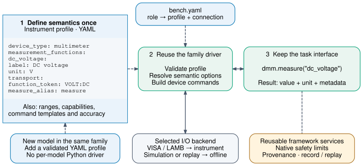

# Define instrument semantics once

PyTestLab separates model-specific instrument knowledge from measurement code.
A YAML profile describes capabilities, ranges, semantic options, command
templates, response information, and available accuracy specifications. A shared
device-type driver exposes these through a consistent Python interface.

For example, the EDU34450A profile maps the public measurement `dc_voltage` to
unit `V` and the private transport token `VOLT:DC`. Task code uses
`dmm.measure("dc_voltage")`. A compatible model can use the same semantic call
with its own profile, without a per-model Python driver.

To integrate a previously unprofiled model, author and validate its YAML profile
against an existing device-type contract, then verify it with the instrument.
A new device type, unsupported operation, or incompatible protocol may require
a driver or backend extension. See [Creating Profiles](../profiles/creating.md).

The bench descriptor binds a role such as `dmm` to that profile and a connection.
Changing this binding keeps setup details out of the measurement logic.
`Bench.open` parses and validates the descriptor and creates a managed session.
Declared routes describe a physical path; a measurement call does not apply them
implicitly.

## Reusable runtime services

Descriptor safety limits can reject a typed operation before backend I/O and
emit a `SafetyLimitError`. An experimental harness may add a separate common
shield beneath multiple substrate lanes; these are distinct boundaries and
should not be conflated when interpreting safety results.

Recording forwards I/O while appending ordered command and response entries.
Replay checks the expected command type and text, returning the recorded
response or raising `ReplayMismatchError`. Replay substitutes I/O for a
software check; it does not reconstruct a physical bench or create new hardware
evidence.

The editable Graphviz source is maintained with the TIM paper. More detailed
[safety](assets/pytestlab_safety_boundaries.svg) and
[replay](assets/pytestlab_record_replay.svg) diagrams are available as references.
